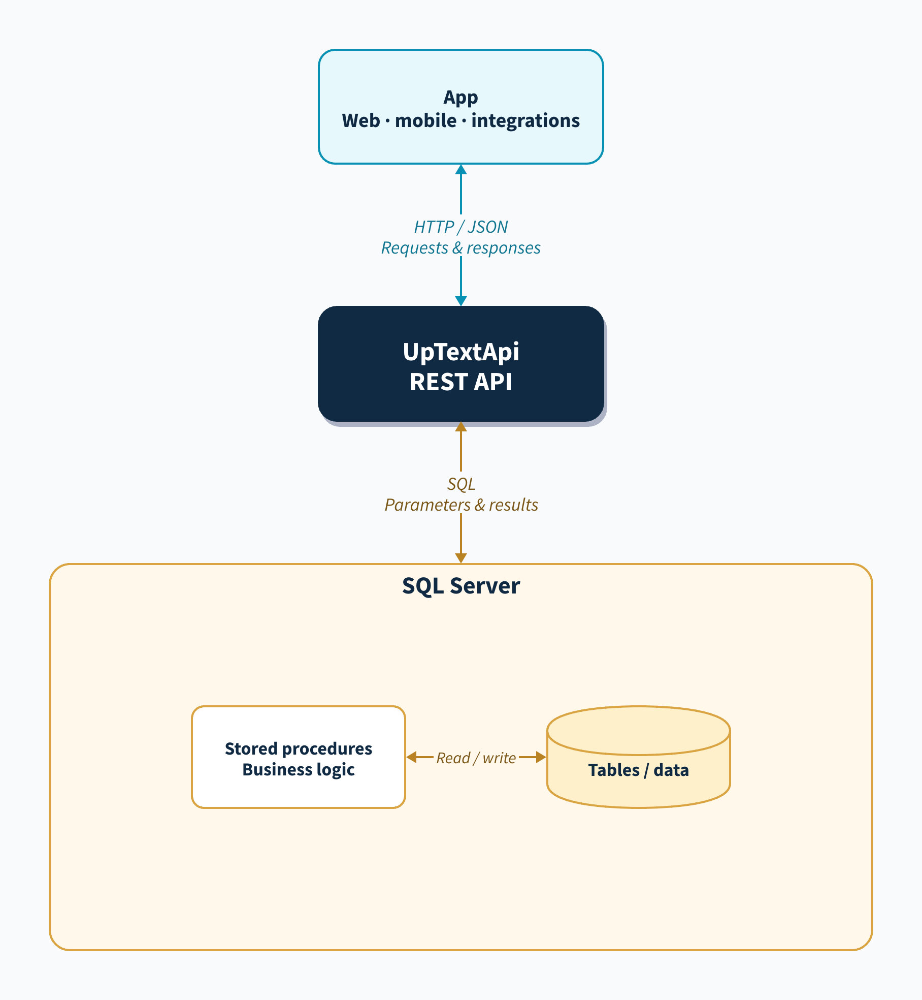

# UpTextApi

`UpTextApi` turns SQL Server stored procedures into a REST API.

You define your API in SQL, not in controllers:

- Create stored procedures like `customers_get`, `customers_post`, `customers_put`, and `customers_delete`
- Point `UpTextApi` at a SQL Server database and schema
- Run the app as a container from Docker Hub or from source
- Get REST endpoints, JWT protection, OpenAPI, and Swagger UI automatically
- Genereate CRUD procedures from your tables


It is built for developers that want a simple SQL-first API layer with very little moving code.

If you now SQL and your database this tool is for you.

## What It Gives You

- SQL-first REST API generation from stored procedures
- SQL Server support
- All REST resources are defined in SQL
- Run from the `uptext/uptextapi` Docker image
- Run from source with `dotnet run`
- Automatic OpenAPI generation per service
- Built-in Swagger UI
- JWT token creation for login endpoints
- JWT-based endpoint protection using SQL parameter naming
- Paging and sorting support through stored procedure parameters
- Binary/file responses from SQL
- Multi-service support through configuration
- Use different SQL Schema for your data and procedures
- Create an api-user on SQL Server that can only execute stored procedures in a given schema

## How It Works



The app sends HTTP requests to UpTextApi, including a JSON body when needed.
UpTextApi passes request values as parameters to stored procedures stored and
executed inside SQL Server. The procedures read or write table data, and
UpTextApi converts the database results into JSON responses for the app.

The [D2 diagram source](docs/diagrams/architecture.d2) can be edited and rendered with:

```sh
d2 docs/diagrams/architecture.d2 docs/diagrams/architecture.svg
d2 docs/diagrams/architecture.d2 docs/diagrams/architecture.png
```

`UpTextApi` maps HTTP verbs to stored procedure names:

- `GET /api/customers` -> `api.customers_get`
- `GET /api/customers/1` -> `api.customers_get @id = 1`
- `POST /api/customers` -> `api.customers_post`
- `PUT /api/customers/1` -> `api.customers_put @id = 1`
- `DELETE /api/customers/1` -> `api.customers_delete @id = 1`

The `api` part part of the request refers to a service definition in the configuration. Each service points to:

- a SQL connection string
- a SQL schema that contains the API stored procedures

Example:

```json
{
  "Services": {
    "api": {
      "SqlSchema": "api",
      "TableSchema": "dbo",
      "SqlGenerator": true,
      "SqlConnectionString": "Server=localhost,1433;Initial Catalog=MyDb;User ID=upservice;Password=VerySecret!321;Encrypt=False;TrustServerCertificate=True;"
    }
  }
}
```

Thus many api's can be hosted by a single container. Also the service user should only have exec permission on the api schema. 

## Requirements

- SQL Server
- Docker for the default container-based setup
- .NET 10 SDK to run from source

## Project Layout

- [`src/UpTextApi/Program.cs`](src/UpTextApi/Program.cs) bootstraps the API
- [`src/UpTextApi/Endpoints/SqlWebApi.cs`](src/UpTextApi/Endpoints/SqlWebApi.cs) exposes the SQL-backed REST endpoints
- [`src/UpTextApi/Endpoints/ServiceOpenApi.cs`](src/UpTextApi/Endpoints/ServiceOpenApi.cs) generates service-specific OpenAPI
- [`src/UpTextApi/Endpoints/SwaggerUi.cs`](src/UpTextApi/Endpoints/SwaggerUi.cs) serves Swagger UI
- [`src/UpTextApi/Endpoints/SqlGenFunc.cs`](src/UpTextApi/Endpoints/SqlGenFunc.cs) can generate CRUD stored procedure templates

## Quick Start

### 1. Run the container from Docker Hub

The default way to run `UpTextApi` is the published Docker image:

```bash
docker run --rm \
  -p 5092:8080 \
  -e ASPNETCORE_URLS=http://+:8080 \
  -e JWT_SECRET=replace-with-a-long-random-secret \
  -e JWT_ISSUER=UpTextApi \
  -e JWT_AUDIENCE=UpTextApiClient \
  -e JWT_HOURS=8 \
  -e Services__api__SqlSchema=api \
  -e Services__api__TableSchema=dbo \
  -e Services__api__SqlGenerator=true \
  -e 'Services__api__SqlConnectionString=Server=host.docker.internal,1433;Initial Catalog=MyDb;User ID=upservice;Password=VerySecret!321;Encrypt=False;TrustServerCertificate=True;' \
  uptext/uptextapi
```

Notes:

- `host.docker.internal` is typically the right server name when SQL Server is running on your machine and `UpTextApi` is inside Docker
- in `zsh`, wrap connection strings in single quotes when the password contains `!`
- this example configures only one service, `api`
- the default local URL is [http://localhost:5092](http://localhost:5092)

Useful built-in routes:

- `/`
- `/ping`
- `/docs`
- `/docs/api`
- `/swagger.json`
- `/api/swagger.json`

### 2. Configure a service

For containers, the recommended approach is environment variables. If you run from source, you can also use [`src/UpTextApi/appsettings.json`](src/UpTextApi/appsettings.json).

Minimal configuration example:

```json
{
  "JWT_SECRET": "replace-with-a-long-random-secret",
  "JWT_ISSUER": "UpTextApi",
  "JWT_AUDIENCE": "UpTextApiClient",
  "JWT_HOURS": "8",
  "Cors": {
    "AllowedOrigins": []
  },
  "Services": {
    "api": {
      "SqlSchema": "api",
      "TableSchema": "dbo",
      "SqlGenerator": true,
      "SqlConnectionString": "Server=localhost,1433;Initial Catalog=MyDb;User ID=upservice;Password=VerySecret!321;Encrypt=False;TrustServerCertificate=True;"
    }
  }
}
```

Recommended:

- keep real secrets out of source control
- use environment variables in production
- use `{{secret:name}}` placeholders for values supplied by Docker Secrets
- keep one SQL schema per API service

Secret placeholders can be used inside configuration values that contain secrets, for example:

```json
{
  "Services": {
    "api": {
      "SqlConnectionString": "Server=localhost,1433;Initial Catalog=MyDb;User ID=upservice;Password={{secret:uptextapi_sql_password}};Encrypt=False;TrustServerCertificate=True;"
    }
  },
  "JWT_SECRET": "{{secret:uptextapi_jwt_secret}}"
}
```

At runtime, `{{secret:uptextapi_sql_password}}` is resolved from either an environment variable named `uptextapi_sql_password` or `UPTEXTAPI_SQL_PASSWORD`, or from a Docker Secret file at `/run/secrets/uptextapi_sql_password`. Set `UPTEXTAPI_SECRETS_DIRECTORY` to use a different secrets directory.

### CORS configuration

CORS is now fully configuration-driven.

Set allowed origins in:

- [`src/UpTextApi/appsettings.Development.json`](src/UpTextApi/appsettings.Development.json) for local development
- [`src/UpTextApi/appsettings.json`](src/UpTextApi/appsettings.json) or environment variables for shared environments and containers

Example:

```json
{
  "Cors": {
    "AllowedOrigins": [
      "https://app.example.com",
      "https://admin.example.com"
    ]
  }
}
```

If `Cors:AllowedOrigins` is empty, `UpTextApi` does not send CORS allow headers, so cross-origin browser requests are not allowed.

### SQL logging

`UpTextApi` can write one row per API execution to SQL Server. This is useful when you want a simple audit trail for requests, status codes, execution time, generated SQL exec strings, request bodies, response bodies, and unexpected errors.

Configure it with a `SqlLog` section:

```json
{
  "SqlLog": {
    "ConnectionString": "Server=localhost,1433;Initial Catalog=MyDb;User ID=upservice;Password=VerySecret!321;Encrypt=False;TrustServerCertificate=True;",
    "Schema": "api",
    "TableName": "log",
    "CleanupEnabled": true,
    "RetentionDays": 30,
    "CleanupBatchSize": 5000
  }
}
```

The equivalent Docker environment variables are:

```text
SqlLog__ConnectionString=Server=...
SqlLog__Schema=api
SqlLog__TableName=log
SqlLog__CleanupEnabled=true
SqlLog__RetentionDays=30
SqlLog__CleanupBatchSize=5000
```

Notes:

- `ConnectionString` enables SQL logging and installs the retention background service
- if `ConnectionString` is empty or absent, the retention background service is not installed
- `Schema` defaults to `dbo`, but `api` is recommended so the log table stays with the rest of the service objects
- `TableName` defaults to `log`
- the schema and table name must be simple SQL identifiers using letters, numbers, or `_`
- `CleanupEnabled` defaults to `true`
- `RetentionDays` defaults to `30`
- `CleanupBatchSize` defaults to `5000`

Retention cleanup runs once when the application starts and every 24 hours after
that. Rows older than `RetentionDays` are deleted in batches. Set
`CleanupEnabled` to `false` to retain rows indefinitely.

For local development, `UpTextApi` can create the log table automatically at startup if it does not already exist.

For production, it is better to have `dbo` pre-create `api.log` and grant
`INSERT`, `SELECT`, and `DELETE` to `upservice`. That keeps the runtime account
from needing table-creation permissions.

Recommended setup:

```sql
CREATE TABLE [api].[log](
    [Id] [int] IDENTITY(1,1) NOT NULL,
    [ApiName] [nvarchar](max) NULL,
    [SwaServer] [nvarchar](max) NULL,
    [MsUsed] [int] NULL,
    [TimeStamp] [datetime] DEFAULT GETDATE(),
    [ReturnValue] [int] NULL,
    [RequestBody] [nvarchar](max) NULL,
    [ReturnBody] [nvarchar](max) NULL,
    [ExecString] [nvarchar](max) NULL,
    [jwt] [nvarchar](max) NULL,
    [UnexpectedError] [nvarchar](max) NULL,
    CONSTRAINT [PK_api_log] PRIMARY KEY CLUSTERED ([Id] ASC)
);

CREATE INDEX [IX_log_TimeStamp] ON [api].[log] ([TimeStamp]);

GRANT INSERT, SELECT, DELETE ON [api].[log] TO upservice;
```

Read log entries with `GET /SqlLog`. All query parameters are optional:

- `service`: match the log row's `ApiName`
- `maxHours`: include entries from the last number of hours
- `aboveTime`: include entries taking longer than this number of milliseconds
- `OnlySqlError=true`: include entries with `ReturnValue >= 500`
- `UserError=true`: include entries with `ReturnValue >= 400` and `< 500`
- `Today=true`: include entries since SQL Server midnight
- `procedure`: include entries where `ExecString` starts with `exec {procedure}`
- `FromRow`: zero-based first row to return; defaults to `0`
- `ToRow`: zero-based last row to return, inclusive; defaults to `100`
- `sortBy`: `time`, `service`, `status`, `duration`, `server`, or `sqlExecution`; defaults to `time`
- `sortDirection`: `asc` or `desc`; defaults to `desc`

Rows are returned newest first by default. If both error flags are `true`, all entries with
`ReturnValue >= 400` are returned.

Open `/sql-log-view` for a browser-based query and paging interface. It displays
20 rows per page and applies the same filters as the JSON endpoint.

Get aggregate totals for one service with
`GET /ServiceLogStatus?service=api`. The response contains call, user-error, and
SQL-error counts for the rolling last hour, today since SQL Server midnight,
and all time.

The home page displays these totals for every configured service. Each value
links to `/sql-log-view` with the matching service, time, and error filters.

Typical uses:

- trace API calls during development
- inspect request and response payloads when debugging procedure behavior
- monitor status codes and execution times
- capture unexpected SQL or application errors for later review

If logging is enabled, every executed endpoint writes a row to the configured log table.

### 3. Create the SQL service user

`UpTextApi` only needs permission to connect to the database and execute stored procedures in the configured schema. Using a dedicated service login instead of `sa` keeps local setup closer to production and limits the blast radius if the API credentials are exposed.

Run this in SQL Server before starting the API:

```sql
CREATE LOGIN upservice WITH PASSWORD = 'VerySecret!321';
CREATE SCHEMA api AUTHORIZATION dbo;
CREATE USER upservice FOR LOGIN upservice;
GRANT CONNECT TO upservice;
GRANT EXECUTE ON SCHEMA::[api] TO upservice;
GRANT SELECT, INSERT, UPDATE, DELETE ON [api].[log] TO upservice;
```

This matches the example connection string above and gives `UpTextApi` access to execute procedures in the `api` schema and write to `api.log` without broader database permissions.

### 4. Create stored procedures

Create your procedures in SQL Server under the configured schema, for example:

- `api.customers_get`
- `api.customers_post`
- `api.customers_put`
- `api.customers_delete`
- `api.customers_openapi` optional, for richer docs

## REST Route Convention

The main route is:

```text
/{service}/{resource}
/{service}/{resource}/{id}
```

Examples:

```text
GET    /api/customers
GET    /api/customers/1
POST   /api/customers
PUT    /api/customers/1
DELETE /api/customers/1
```

Stored procedure naming:

```text
customers_get
customers_post
customers_put
customers_delete
```

The configured SQL schema is prepended automatically, for example `api.customers_get`.

## Complete CRUD Demo

This demo is written for a DBA working in SQL Server Management Studio (SSMS). At the end, you will have:

- a new SQL Server database
- an `api` schema that holds the REST-facing stored procedures
- an `upservice` login and user with minimal permissions
- a `dbo.customers` table with demo data
- CRUD stored procedures for `Customer`
- an `UpTextApi` container running from Docker Hub

After the container starts, the first URL to try is:

- [http://localhost:5092/api/customers](http://localhost:5092/api/customers)

Then open Swagger UI for the same demo service:

- [http://localhost:5092/docs/api](http://localhost:5092/docs/api)

The generated OpenAPI document for the demo service is here:

- [http://localhost:5092/api/swagger.json](http://localhost:5092/api/swagger.json)

### 1. Create the demo database in SSMS

Open a new query window in SSMS as a sufficiently privileged login such as `sa`, then run the full script below. It creates everything needed for the demo in one go.

```sql
USE master;
GO

IF DB_ID('UpTextApiDemo') IS NULL
BEGIN
    CREATE DATABASE UpTextApiDemo;
END;
GO

IF NOT EXISTS (SELECT 1 FROM sys.server_principals WHERE name = 'upservice')
BEGIN
    CREATE LOGIN upservice WITH PASSWORD = 'VerySecret!321';
END;
GO

USE UpTextApiDemo;
GO

IF NOT EXISTS (SELECT 1 FROM sys.schemas WHERE name = 'api')
BEGIN
    EXEC('CREATE SCHEMA api AUTHORIZATION dbo;');
END;
GO

IF NOT EXISTS (SELECT 1 FROM sys.database_principals WHERE name = 'upservice')
BEGIN
    CREATE USER upservice FOR LOGIN upservice;
END;
GO

GRANT CONNECT TO upservice;
GRANT EXECUTE ON SCHEMA::[api] TO upservice;
GO

IF OBJECT_ID('dbo.customers', 'U') IS NOT NULL
BEGIN
    DROP TABLE dbo.customers;
END;
GO

CREATE TABLE dbo.customers
(
    Id int IDENTITY(1,1) NOT NULL PRIMARY KEY,
    Name nvarchar(100) NOT NULL,
    Email nvarchar(200) NULL,
    City nvarchar(100) NULL,
    CreatedAt datetime2 NOT NULL CONSTRAINT DF_customers_CreatedAt DEFAULT SYSUTCDATETIME()
);
GO

INSERT INTO dbo.customers (Name, Email, City)
VALUES
    ('Ada Lovelace', 'ada@example.com', 'London'),
    ('Grace Hopper', 'grace@example.com', 'New York'),
    ('Linus Torvalds', 'linus@example.com', 'Helsinki');
GO

CREATE OR ALTER PROCEDURE api.customers_get
    @Id varchar(max) = NULL,
    @first_row int = NULL,
    @last_row int = NULL,
    @sort_field nvarchar(128) = NULL,
    @sort_order nvarchar(4) = NULL,
    @filter nvarchar(max) = NULL,
    @total_rows int OUTPUT
AS
BEGIN
    SET NOCOUNT ON;

    DECLARE @IdInt int = TRY_CAST(@Id AS int);
    DECLARE @SortField nvarchar(128) = LOWER(COALESCE(@sort_field, 'id'));
    DECLARE @SortOrder nvarchar(4) = UPPER(COALESCE(@sort_order, 'ASC'));
    DECLARE @Offset int = CASE WHEN @first_row IS NULL OR @first_row < 0 THEN 0 ELSE @first_row END;
    DECLARE @Fetch int = CASE
        WHEN @last_row IS NULL OR @last_row < @Offset THEN 2147483647
        ELSE (@last_row - @Offset) + 1
    END;
    
    SELECT @total_rows = COUNT(*)
    FROM dbo.customers
    WHERE (@IdInt IS NULL OR Id = @IdInt)
      AND (
            @filter IS NULL
            OR Name LIKE '%' + @filter + '%'
            OR Email LIKE '%' + @filter + '%'
            OR City LIKE '%' + @filter + '%'
          );

    SELECT
        Id,
        Name,
        Email,
        City,
        CreatedAt
    FROM dbo.customers
    WHERE (@IdInt IS NULL OR Id = @IdInt)
      AND (
            @filter IS NULL
            OR Name LIKE '%' + @filter + '%'
            OR Email LIKE '%' + @filter + '%'
            OR City LIKE '%' + @filter + '%'
          )
    ORDER BY
        CASE WHEN @SortField = 'name' AND @SortOrder = 'ASC' THEN Name END ASC,
        CASE WHEN @SortField = 'name' AND @SortOrder = 'DESC' THEN Name END DESC,
        CASE WHEN @SortField = 'email' AND @SortOrder = 'ASC' THEN Email END ASC,
        CASE WHEN @SortField = 'email' AND @SortOrder = 'DESC' THEN Email END DESC,
        CASE WHEN @SortField = 'city' AND @SortOrder = 'ASC' THEN City END ASC,
        CASE WHEN @SortField = 'city' AND @SortOrder = 'DESC' THEN City END DESC,
        CASE WHEN @SortField = 'createdat' AND @SortOrder = 'ASC' THEN CreatedAt END ASC,
        CASE WHEN @SortField = 'createdat' AND @SortOrder = 'DESC' THEN CreatedAt END DESC,
        CASE WHEN @SortField = 'id' AND @SortOrder = 'DESC' THEN Id END DESC,
        Id ASC
    OFFSET @Offset ROWS
    FETCH NEXT @Fetch ROWS ONLY;

    RETURN 200;
END;
GO

CREATE OR ALTER PROCEDURE api.customers_post
    @Name nvarchar(100),
    @Email nvarchar(200) = NULL,
    @City nvarchar(100) = NULL
AS
BEGIN
    SET NOCOUNT ON;

    INSERT INTO dbo.customers (Name, Email, City)
    VALUES (@Name, @Email, @City);

    DECLARE @NewId int = SCOPE_IDENTITY();

    EXEC api.customers_get @Id = @NewId;
    RETURN 200;
END;
GO

CREATE OR ALTER PROCEDURE api.customers_put
    @Id varchar(max),
    @Name nvarchar(100) = NULL,
    @Email nvarchar(200) = NULL,
    @City nvarchar(100) = NULL
AS
BEGIN
    SET NOCOUNT ON;

    DECLARE @IdInt int = TRY_CAST(@Id AS int);

    IF @IdInt IS NULL OR NOT EXISTS (SELECT 1 FROM dbo.customers WHERE Id = @IdInt)
    BEGIN
        RAISERROR('Unknown customer', 1, 1);
        RETURN 404;
    END;

    UPDATE dbo.customers
    SET
        Name = COALESCE(@Name, Name),
        Email = COALESCE(@Email, Email),
        City = COALESCE(@City, City)
    WHERE Id = @IdInt;

    EXEC api.customers_get @Id = @IdInt;
    RETURN 200;
END;
GO

CREATE OR ALTER PROCEDURE api.customers_delete
    @Id varchar(max)
AS
BEGIN
    SET NOCOUNT ON;

    DECLARE @IdInt int = TRY_CAST(@Id AS int);

    IF @IdInt IS NULL OR NOT EXISTS (SELECT 1 FROM dbo.customers WHERE Id = @IdInt)
    BEGIN
        RAISERROR('Unknown customer', 1, 1);
        RETURN 404;
    END;

    DELETE FROM dbo.customers
    WHERE Id = @IdInt;

    RETURN 200;
END;
GO

CREATE OR ALTER PROCEDURE api.customers_openapi
AS
BEGIN
    SET NOCOUNT ON;

    SELECT
        operation,
        class,
        name,
        property,
        value
    FROM (VALUES
        ('get',    'operation', '',           'summary',     'Get one customer or a paged list of customers'),
        ('post',   'operation', '',           'summary',     'Create a customer'),
        ('put',    'operation', '',           'summary',     'Update a customer'),
        ('delete', 'operation', '',           'summary',     'Delete a customer'),
        ('*',      'parameter', 'Id',         'description', 'Customer id from the route'),
        ('get',    'parameter', 'filter',     'description', 'Searches Name, Email, and City'),
        ('get',    'parameter', 'sort',       'description', 'Example: [\"Name\",\"ASC\"]'),
        ('get',    'parameter', 'range',      'description', 'Example: [0,24] for server-side paging'),
        ('*',      'response',  '404',        'description', 'Customer not found')
    ) AS Data(operation, class, name, property, value);
END;
GO
```

### 2. Verify the database objects in SSMS

You should now see:

- database `UpTextApiDemo`
- schema `api`
- table `dbo.customers`
- procedures `api.customers_get`, `api.customers_post`, `api.customers_put`, `api.customers_delete`, and `api.customers_openapi`
- database user `upservice`

You can also validate the seed data directly in SSMS:

```sql
USE UpTextApiDemo;
GO

SELECT * FROM dbo.customers ORDER BY Id;
GO
```

### 3. Start the container from Docker Hub

Run `UpTextApi` as a container with a minimal configuration that only defines the `api` service:

```bash
docker run --rm \
  -p 5092:8080 \
  -e ASPNETCORE_URLS=http://+:8080 \
  -e JWT_SECRET=replace-with-a-long-random-secret \
  -e JWT_ISSUER=UpTextApi \
  -e JWT_AUDIENCE=UpTextApiClient \
  -e JWT_HOURS=8 \
  -e Services__api__SqlSchema=api \
  -e Services__api__SqlConnectionString="Server=host.docker.internal,1433;Initial Catalog=UpTextApiDemo;User ID=upservice;Password=VerySecret!321;Encrypt=False;TrustServerCertificate=True;" \
  uptext/uptextapi
```

Notes:

- `host.docker.internal` lets the container connect back to SQL Server running on your machine
- if SQL Server is on another host, replace `host.docker.internal` with that server name
- only one service is configured here: `api`

### 4. Open the demo endpoints

First, list the customers:

- [http://localhost:5092/api/customers](http://localhost:5092/api/customers)

That endpoint should return the seed rows from `dbo.customers`.

Then open Swagger UI for the demo service:

- [http://localhost:5092/docs/api](http://localhost:5092/docs/api)

Swagger UI lets you inspect and execute the demo CRUD operations against:

- `GET /api/customers`
- `GET /api/customers/{id}`
- `POST /api/customers`
- `PUT /api/customers/{id}`
- `DELETE /api/customers/{id}`

The service-specific OpenAPI document is also available here:

- [http://localhost:5092/api/swagger.json](http://localhost:5092/api/swagger.json)

### 5. Optional command-line tests

Create a customer:

```bash
curl -X POST http://localhost:5092/api/customers \
  -H "Content-Type: application/json" \
  -d '{"name":"Margaret Hamilton","email":"margaret@example.com","city":"Boston"}'
```

Update customer `1`:

```bash
curl -X PUT http://localhost:5092/api/customers/1 \
  -H "Content-Type: application/json" \
  -d '{"city":"Oslo"}'
```

Delete customer `3`:

```bash
curl -X DELETE http://localhost:5092/api/customers/3
```

### Summary

You have created a REST API for CRUD operations on a `Customer` resource with SQL Server objects that a DBA can own and maintain.

You can extend the demo with:

- authentication by adding procedures such as `api.login_post` and protected parameters such as `@auth_userid`
- server-side paging with `@first_row`, `@last_row`, and `@total_rows`
- sorting with `@sort_field` and `@sort_order`
- searching with `@filter`
- SQL logging to an `api.log` table for request and response auditing
- CORS configuration through `Cors:AllowedOrigins` or matching environment variables

## JWT Authentication

JWT is built in.

Two important conventions are used:

### 1. `login_post` can generate a token

If you create a procedure named `login_post`, `UpTextApi` can turn its result into a JWT response:

```text
POST /api/login
```

The procedure must return the user's stored Argon2id hash through
`@passwordHash nvarchar(256) OUTPUT`, together with one row or a JSON object of
claims. The API verifies the request's `password` against that hash before issuing
a token. The output hash is removed before constructing claims or responses.
After successful verification, the API responds with
`200 OK` and `Content-Type: text/plain`. The response body is the raw JWT token,
without JSON wrapping or quotation marks:


If the credentials do not match, return no rows. `UpTextApi` responds with `401 Unauthorized`
and `{"message":"Invalid username or password"}`.

#### Password storage and SQL login contract

Registration and password-change procedures that accept `@passwordHash` receive an
Argon2id hash derived automatically from the incoming `password`. Each hash uses a
cryptographically random 16-byte salt, 19 MiB of memory, 2 iterations, parallelism 1,
and a 32-byte result. The encoded value includes the algorithm, version, parameters,
salt, and hash. Store it verbatim in a `varchar(256)` or `nvarchar(256)` column; no
separate salt column or shared secret is needed. Client-supplied `passwordHash`
values are ignored. A missing password supplies SQL NULL; creation procedures must
reject it, and update procedures must handle it explicitly.

`login_post` looks up the account by username and returns its stored hash, rather
than comparing a newly calculated hash in SQL. Adapt table and column names to your
database:

```sql
CREATE OR ALTER PROCEDURE api.login_post
    @username nvarchar(200),
    @passwordHash nvarchar(256) = NULL OUTPUT
AS
BEGIN
    SET NOCOUNT ON;
    SET @passwordHash = NULL;

    SELECT @passwordHash = PasswordHash
    FROM dbo.Users
    WHERE Username = @username;

    IF @passwordHash IS NULL RETURN 401;

    SELECT Id AS userid, Username AS username
    FROM dbo.Users
    WHERE Username = @username;
    RETURN 200;
END;
```

Use a unique username constraint. Return only non-sensitive claims in the result
row; never SELECT the password hash into the result set. The API initializes the
output hash to NULL, verifies it after SQL completes, and rejects missing hashes,
unsupported hash formats, wrong passwords, and unsuccessful SQL status codes.
This lookup procedure runs **before** password verification: it must not record a
successful login or perform privileged side effects. Send credentials in a JSON
POST body over HTTPS, not in URLs.

**Deployment/migration:** update the login procedure and widen password-hash columns
and procedure parameters before deploying this version. Old SHA-256 hashes are not
accepted and cannot be converted without the password. Existing accounts require a
trusted password-reset flow that writes the new hash. Automatic legacy-hash migration
is not implemented. Coordinate this change with registration and password-change
procedures; old SQL hash-equality login procedures will no longer work.

For the development `UpCrm` database, the reviewed migration is
[`20260928_crm_argon2id.sql`](src/UpTextApi/Sql/Migrations/20260928_crm_argon2id.sql).
It widens `crm.sales.PasswordHash` and the password parameters on
`crmapi.tenants_post`, `crmapi.sales_post`, `crmapi.sales_Password_Put`, and
`crmapi.Login_Post`. Login retains tenant and disabled-account checks and returns
the stored hash as an output parameter. Password writes reject missing or
non-Argon2id values. Run the script with a migration account during the API
deployment; the application account does not have the required ALTER permissions.
The script is transactional, checks for unexpected procedure changes, and preserves
all existing password values. It does not migrate legacy passwords.

Run the password-security checks with:

```bash
dotnet run --project tests/PasswordSecurity
```

### 2. `@auth_*` parameters protect endpoints

If a stored procedure has parameters like:

```sql
@auth_userid nvarchar(100)
```

then `UpTextApi`:

- expects `Authorization: Bearer <token>`
- validates the JWT
- reads the matching claim from the token
- injects it into the stored procedure parameter
- marks the endpoint as secured in OpenAPI

Example protected procedure:

```sql
CREATE OR ALTER PROCEDURE api.Profile_get
    @auth_userid nvarchar(100)
AS
SELECT
    UserId,
    DisplayName,
    Email
FROM dbo.Users
WHERE UserId = @auth_userid;
GO
```

Call it:

```bash
curl http://localhost:5092/api/profile \
  -H "Authorization: Bearer YOUR_TOKEN"
```

## OpenAPI And Swagger UI

`UpTextApi` generates documentation automatically.

Built-in docs endpoints:

- `/swagger.json` for the app-level OpenAPI document
- `/{service}/swagger.json` for service-specific SQL-generated OpenAPI
- `/docs` for Swagger UI
- `/docs/{service}` for a service Swagger UI page

Set `SQLWEBAPI__HOMEKEY` to require a HomeKey for Swagger UI, generated OpenAPI JSON, SQL generator pages/API calls, and SQL log pages/API calls. The root home page stays public so it can show the key input. Accepted inputs are `?homeKey=...`, `?HomeKey=...`, `?key=...`, or the `X-Home-Key` header.

Examples:

```text
http://localhost:5092/docs
http://localhost:5092/docs/api
http://localhost:5092/api/swagger.json
```

### Add better docs with `<resource>_openapi`

You can enrich generated docs with a companion procedure:

```text
api.customers_openapi
```

It returns rows describing summaries, descriptions, parameter descriptions, tags, and response descriptions.

Example:

```sql
CREATE OR ALTER PROCEDURE api.customers_openapi
AS
SELECT
    operation,
    class,
    name,
    property,
    value
FROM (VALUES
    ('*',      'parameter', 'Id',    'description', 'customer id'),
    ('get',    'operation', '',      'summary',     'Get one or many customers'),
    ('post',   'operation', '',      'summary',     'Create a customer'),
    ('put',    'operation', '',      'summary',     'Update a customer'),
    ('delete', 'operation', '',      'summary',     'Delete a customer'),
    ('*',      'response',  '404',   'description', 'customer not found')
) AS Data(operation, class, name, property, value);
GO
```

For the full shape, see [`src/UpTextApi/Docs/ServiceOpenApi.md`](src/UpTextApi/Docs/ServiceOpenApi.md).

## SQL Generator

`UpTextApi` can generate starter SQL for a table.

Routes:

- `/SqlGenerator`
- `/{service}/sql-generator`
- `/sql-generator/{service}/{tableSchema}` (HTML UI)

Example:

```bash
curl "http://localhost:5092/api/sql-generator?Table-schema=dbo&Table=customers&http-verb=all"
```

Supported values for `http-verb`:

- `get`
- `post`
- `put`
- `delete`
- `all`

Optional flags:

- `Paging=true`
- `Sort=true`
- `Search=true`

Set `Services:{service}:SqlGenerator` to `false` to disable SQL generation and
hide that service's generator link from the home page. The setting defaults to
`true` for backward compatibility.

Set `Services:{service}:TableSchema` to the schema containing the source tables.
It defaults to `dbo` and is included in the SQL generator UI URL.

## Paging, Sorting, And Filtering

If your procedure supports these parameters, `UpTextApi` knows how to populate them:

- `@first_row`
- `@last_row`
- `@sort_field`
- `@sort_order`
- `@filter`

Example request:

```bash
curl "http://localhost:5092/api/customers?range=[0,24]&sort=[\"Name\",\"ASC\"]&filter=ada"
```

For successful collection `GET` responses, `UpTextApi` also emits a `Content-Range` header.

## Useful Stored Procedure Conventions

These conventions are recognized by the runtime:

- `@id` is filled from `/resource/{id}` when not present in the query string
- `@requestBody` receives the raw request body
- `@requestHeaders` receives request headers as JSON
- `@url` receives the full request URL
- `@passwordHash` can be derived from an incoming `password`
- `@body` output can replace the normal response payload
- `@total_rows` output can control paging totals
- non-zero SQL return values are used as HTTP status codes

This lets you keep more API behavior inside SQL when needed.

## Binary Responses

Stored procedures can also return files or images.

If a result contains:

- first column named `content_type`
- second column containing bytes

then `UpTextApi` returns that as a binary HTTP response.

## Why Teams Use This

- Very low ceremony for CRUD APIs
- SQL-centric development model
- Good fit for internal apps, admin tools, and line-of-business systems
- Easy to expose existing database logic as HTTP
- Swagger and JWT come built in instead of as extra projects

## Notes

- This project targets `net10.0`
- It is designed for SQL Server
- The default `appsettings.json` in the repo should be treated as local/dev configuration, not production secrets

## Run From Source

Most users should run `UpTextApi` from Docker Hub. Running from source is mainly useful when you are developing or debugging the project itself.

Run directly with the .NET SDK:

```bash
dotnet run --project "$HOME/UpText/Repos/UpTextApi/src/UpTextApi/UpTextApi.csproj"
```

Build the container locally instead of pulling `uptext/uptextapi`:

```bash
docker build -f "$HOME/UpText/Repos/UpTextApi/src/UpTextApi/Dockerfile" -t uptextapi "$HOME/UpText/Repos/UpTextApi/src"
```

Configuration can come from:

- environment variables
- [`src/UpTextApi/appsettings.json`](src/UpTextApi/appsettings.json)
- [`src/UpTextApi/appsettings.Development.json`](src/UpTextApi/appsettings.Development.json)

## Next Things To Add

Good additions for this project could be:

- a sample database script under `/samples`
- a `docker-compose.yml` with SQL Server and `UpTextApi`
- a production deployment example
- example login/auth SQL scripts
- integration tests for the CRUD flow
